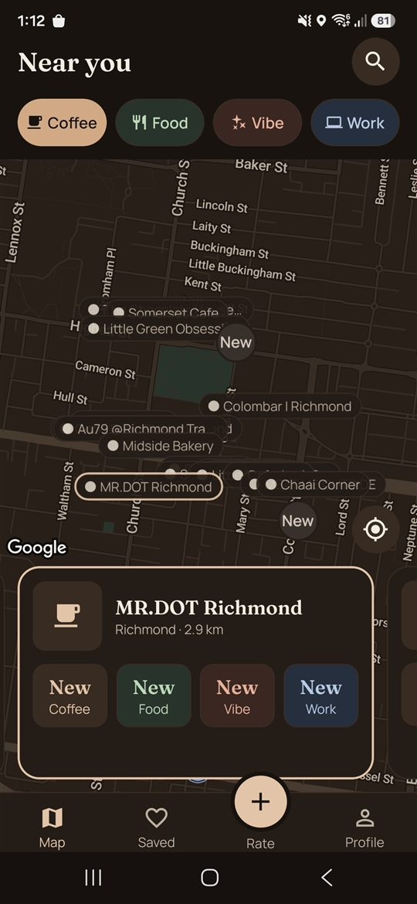
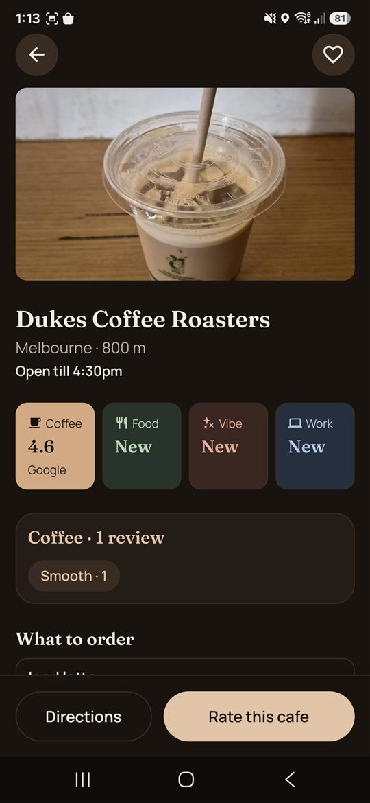
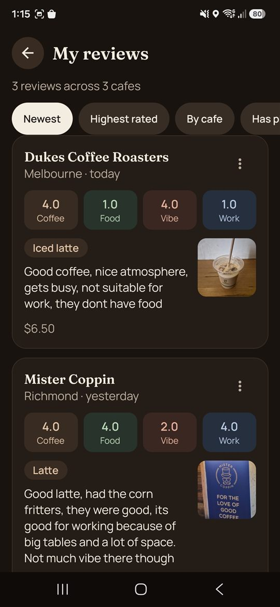
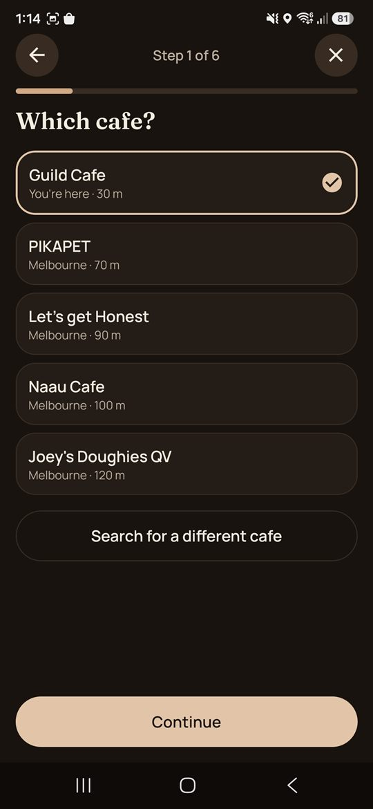
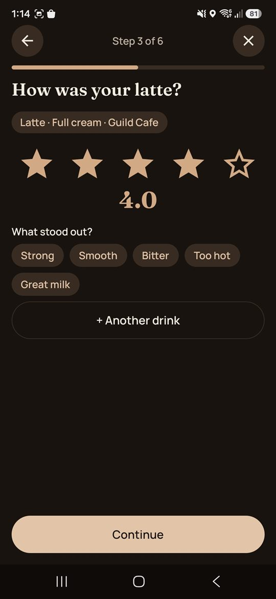
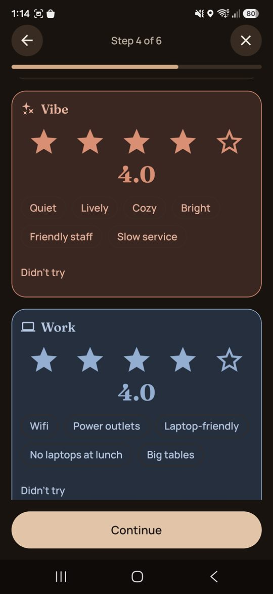
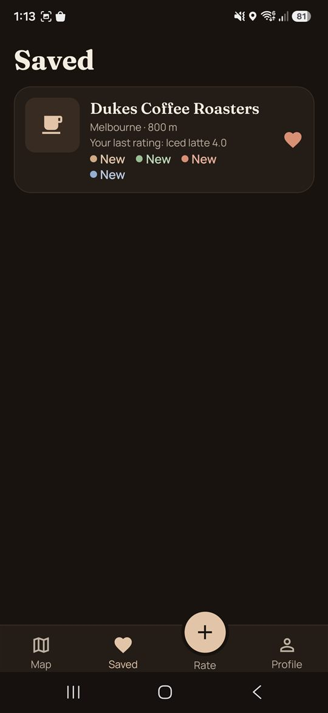

# Cupping — Coffee Rater

A mobile app for finding good cafes and rating what you drink. Google gives a cafe one star rating.
Cupping rates it on four separate things: **Coffee**, **Food**, **Vibe** and **Work**. You can find the
best flat white nearby, or a quiet place with power outlets to work from.

Built with React Native (Expo) and Supabase. It runs on iOS and Android and is in preview testing ahead
of its store release.

<p align="center">
  
  
  
</p>

## Features

- **Map of nearby cafes.** Pins cluster as you zoom out. Switch the map between Coffee, Food, Vibe and Work
  to rank cafes by the thing you care about. Swipe through cafe cards along the bottom.
- **Cafe pages.** A score for each metric, the most common tags ("Smooth", "Great milk", "Power outlets"),
  what to order, photos, live opening hours, and directions. Cafes with fewer than 3 ratings show "New"
  and fall back to the Google rating.
- **A six-step review wizard.** Pick the cafe (nearest first, with a "You're here" check), add one or
  more drinks, rate each one, then rate Food, Vibe and Work with tags. Finish with a comment, price and
  photo. Drafts survive leaving the app.
- **Verified visits.** A review written within 100 m of the cafe gets a verified badge.
- **Saved cafes and My reviews.** Your reviews can be sorted, edited and deleted.
- **Accounts.** Email, Google and Sign in with Apple. Password reset and account deletion are included.
- **Trust and safety.** Report a review, block a person, and a documented moderation process
  ([moderation.md](markdown/moderation.md)), as both app stores require for user content.
- **Light and dark themes**, and an offline banner.

<p align="center">
  
  
  
  
</p>

## How scores work

A cafe's score is not a plain average. Each metric uses a **Bayesian average**: a cafe's ratings are
blended with the city average using a prior weight of 5 ratings. One 5-star review can't put a new cafe
at the top. Ratings also **decay with a 12-month half-life**, so a cafe that has improved (or slipped)
shows it. The same score is shown on screen and used for ranking, so pin order and the numbers always
agree. All of this runs in Postgres (`scoring_constants()`, in
[supabase/migrations](supabase/migrations)). The reasons for each choice are in
[decisions.md](markdown/decisions.md).

## Tech stack

| Area           | Tools                                                                                |
| -------------- | ------------------------------------------------------------------------------------ |
| App            | React Native 0.88, Expo SDK 58, Expo Router, TypeScript                              |
| State and data | TanStack Query, React Hook Form, Zod                                                 |
| UI             | Reanimated, Gesture Handler, Bottom Sheet, react-native-maps (Google Maps), Supercluster |
| Backend        | Supabase: Postgres, row-level security, Auth, Storage                                |
| Server code    | Supabase Edge Functions (Deno): Google Places proxy, account deletion                |
| Testing        | Jest, React Native Testing Library, pgTAP                                            |
| Delivery       | GitHub Actions, EAS Build, EAS Update, Sentry                                        |

## Architecture

```
Mobile app (Expo)
  │
  ├── Supabase Postgres ── tables, RLS policies, SQL functions for scoring,
  │                        map queries and review submission
  ├── Supabase Storage  ── review photos
  ├── Supabase Auth     ── email, Google, Apple
  └── Edge Functions    ── places-search / places-details → Google Places API
                           delete-account → removes photos, then the user
```

The database does most of the work:

- **Row-level security** controls access. People can edit only their own reviews. Blocking someone
  hides their reviews and photos at the database level, not just in the app. Reports can't be read back
  by anyone in the app.
- **Writes go through SQL functions.** For example, `submit_review` saves a review and its drinks,
  ratings and tags in one transaction, and checks the verified-visit distance. Constraints enforce
  rules such as one review per cafe per day.
- **Map queries run in one pass.** One function returns the cafes in the visible map area with their
  scores.

The Google Places API key never ships in the app. Edge Functions proxy every Places request, which also
lets the server control caching. Google's terms say which fields may be stored and for how long, and the
cache follows those rules ([decisions.md](markdown/decisions.md#google-maps-platform)).

### Project layout

```
src/
  app/          Screens and routes (Expo Router)
  features/     Feature code: map, cafe, review-wizard, saved, profile, auth, safety, onboarding
  components/   Shared UI (buttons, star input, score tiles, tag chips)
  domain/       Rules and schemas shared across features (ratings, drinks, limits)
  lib/          Supabase client, query setup, theme, copy, generated database types
supabase/
  migrations/   Schema, RLS, scoring and query functions
  functions/    Edge Functions (Deno)
  tests/        pgTAP database tests
docs-site/      Privacy policy, terms and account deletion pages
markdown/       Build plan, decisions log, moderation process
```

## Testing and CI

The database was built test-first. **16 pgTAP suites** cover constraints, row-level security, scoring,
review submission, map queries, storage and grants. The app has Jest and React Native Testing Library
tests for domain rules and components.

Every push and pull request runs two jobs in [GitHub Actions](.github/workflows/ci.yml):

- **App:** ESLint, Prettier check, TypeScript typecheck, Jest
- **Database:** starts a local Supabase stack and runs the pgTAP suites

## Running it locally

You need Node (LTS), the [Supabase CLI](https://supabase.com/docs/guides/cli) with Docker, and an Android
or iOS development build. The app uses native modules (maps, Google sign-in), so it doesn't run in Expo
Go.

```bash
npm install
npm run db:start        # start local Supabase
npm run db:reset        # apply migrations and seed data
```

Create `.env.local` with:

```bash
EXPO_PUBLIC_SUPABASE_URL=
EXPO_PUBLIC_SUPABASE_ANON_KEY=
EXPO_PUBLIC_GOOGLE_WEB_CLIENT_ID=
EXPO_PUBLIC_GOOGLE_IOS_CLIENT_ID=
GOOGLE_IOS_URL_SCHEME=
GOOGLE_MAPS_ANDROID_KEY=
GOOGLE_MAPS_IOS_KEY=
EXPO_PUBLIC_SENTRY_DSN=      # optional
```

Then build and run:

```bash
npm run android         # or: npx expo run:ios
```

Other scripts:

```bash
npm test                # Jest
npm run db:test         # pgTAP database tests
npm run lint
npm run typecheck
npm run format:check
npm run db:types        # regenerate src/lib/database.types.ts
```

## Project docs

- [Build plan](markdown/BUILD_PLAN.md): milestones from foundations to release
- [Decisions](markdown/decisions.md): what was decided and why
- [Moderation](markdown/moderation.md): how reports, blocks and bans are handled
